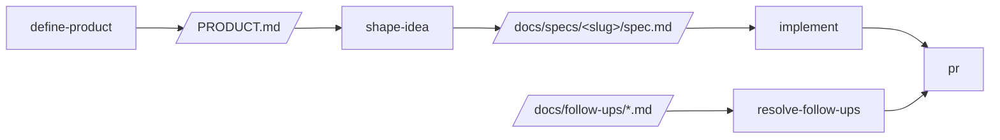

# Claude Code Playbook Template

[](https://www.claude-hunt.com)
[](https://docs.claude-hunt.com)

> [Claude Hunt](https://www.claude-hunt.com) 강의용 Next.js 16 + React 19 템플릿.
> 사용법과 워크플로우 문서는 [docs.claude-hunt.com](https://docs.claude-hunt.com)에서 확인하세요.

## 기술 스택

Next.js 16 (App Router) · React 19 · Tailwind CSS 4 · shadcn/ui · Bun · Vitest · Playwright

## 시작하기

```bash
bun install
bun dev
```

[http://localhost:3000](http://localhost:3000)에서 결과를 확인할 수 있습니다.

## 스크립트

| 명령어 | 설명 |
|---|---|
| `bun dev` | 개발 서버 실행 |
| `bun run build` | 프로덕션 빌드 |
| `bun start` | 프로덕션 서버 실행 |
| `bun run lint` | ESLint 실행 |
| `bun run typecheck` | `tsc --noEmit` 타입 검사 |
| `bun run test` | Vitest 단위/컴포넌트 테스트 1회 실행 |
| `bun run test:watch` | Vitest watch 모드 |
| `bun run test:e2e` | Playwright E2E 테스트 실행 |

## 테스트

- **단위·컴포넌트**: Vitest + Testing Library. 설정은 `vitest.config.mts`, 매처와 cleanup은 `vitest.setup.ts`에 있습니다. 테스트 파일은 소스 옆에 `*.test.ts(x)`로 둡니다(`app/page.test.tsx`, `lib/utils.test.ts` 참고). `globals`를 켜지 않았으므로 `describe`/`it`/`expect`는 `vitest`에서 import 합니다.
- **E2E**: Playwright. 설정은 `playwright.config.ts`, 테스트는 `e2e/*.spec.ts`에 둡니다. `webServer`가 `bun run dev`를 자동으로 띄우므로 별도 서버 실행이 필요 없습니다.

E2E를 처음 실행하기 전에 브라우저를 한 번 내려받아야 합니다.

```bash
bunx playwright install chromium
```

브라우저가 이미 설치된 환경(예: Claude Code 원격 세션)에서는 내려받는 대신 실행 파일 경로를 지정할 수 있습니다.

```bash
PLAYWRIGHT_CHROMIUM_PATH=/opt/pw-browsers/chromium bun run test:e2e
```

`async` Server Component는 Vitest가 아직 지원하지 않으므로 E2E로 검증합니다.

- **런타임 검증(에이전트용)**: [agent-browser](https://github.com/vercel-labs/agent-browser). 에이전트가 `next-dev-loop` 스킬로 실행 중인 앱을 직접 조작해 변경을 확인할 때 씁니다. 프로젝트 의존성이 아니므로 한 번 전역으로 설치합니다.

```bash
npm i -g agent-browser
agent-browser install  # 설치된 Chrome이 없을 때만
```

## 사용 랭킹 서버

교육생이 하루 단위 사용량 숫자(토큰, 세션 수, 사용 시간, 도구 호출, 컨텍스트 %)를 보내면 순위를 매기고 서로 비교합니다. 대화 내용, 파일 경로, 프로젝트 이름은 보내지 않습니다.

1. 스키마를 적용합니다. 원격 프로젝트에 다른 앱의 마이그레이션이 있어 `db push` 대신 SQL을 직접 실행하고 이력을 맞춥니다. CLI v3는 원격 변경 전에 확인을 묻습니다.

   ```bash
   npx supabase link --project-ref earzkbjauzdcanicadlf
   npx supabase db query --remote -f supabase/migrations/20261119000000_ranking.sql
   npx supabase db query --remote -f supabase/migrations/20261119052601_auth_profiles_and_ranking_accounts.sql
   npx supabase migration repair --status applied 20261119000000 20261119052601 --remote
   ```

2. 서버를 띄웁니다(`bun dev`). Supabase 주소와 publishable key는 [lib/supabase/config.ts](lib/supabase/config.ts)에 기본값이 있고, `NEXT_PUBLIC_SUPABASE_URL`, `NEXT_PUBLIC_SUPABASE_PUBLISHABLE_KEY`로 바꿀 수 있습니다.
3. 이메일과 비밀번호로 가입하거나 로그인한 뒤 `/settings`에서 표시 이름(랭킹 닉네임)을 정하고 전송 토큰을 받습니다.
4. 각자 PC에서 기록을 보냅니다. 토큰과 서버 주소는 `~/.my-claude-inspector/ranking.json`에 저장되어 다음부터는 옵션 없이 실행하면 됩니다.

```bash
bun run ranking:submit -- --token mci_... --server http://localhost:3000
bun run ranking:submit                # 저장된 토큰으로 다시 보내기
bun run ranking:submit -- --dry-run   # 보낼 숫자만 확인
```

| API | 설명 |
|---|---|
| `POST /api/ranking/submit` | `{ token, days[] }` 토큰 주인 계정의 하루 기록 등록·갱신 |
| `GET /api/ranking/leaderboard?metric=&period=` | 지표별 순위. `period`는 일 수(0은 전체) |
| `GET /api/ranking/compare?nicknames=a,b&period=` | 모든 지표의 순위와 평균 비교 |
| `GET /api/ranking/metrics` | 지표 목록 |

화면은 `/ranking`(로그인하면 내 비교가 자동으로 열림), `/auth/login`, `/auth/sign-up`, `/settings`입니다. 화면 스타일은 [Claude Style](https://github.com/mr5pm-public/claude-style-obsidian)을 semantic token으로 옮긴 어두운 테마입니다.
1. 스키마를 한 번 적용합니다. 원격 프로젝트에 다른 앱의 마이그레이션이 있어 `db push` 대신 아래처럼 SQL을 직접 실행하고 이력을 맞춥니다(SQL Editor에 붙여 넣어도 됩니다).

   ```bash
   npx supabase link --project-ref earzkbjauzdcanicadlf
   npx supabase db query --remote -f supabase/migrations/20261119000000_ranking.sql
   npx supabase migration repair --status applied 20261119000000 --remote
   ```

2. 서버를 띄웁니다(`bun dev`). Supabase 주소와 publishable key는 코드에 기본값이 있고, `NEXT_PUBLIC_SUPABASE_URL`, `NEXT_PUBLIC_SUPABASE_PUBLISHABLE_KEY`로 바꿀 수 있습니다.
3. 각자 PC에서 기록을 보냅니다. 처음 보낼 때 만든 비밀값은 `~/.my-claude-inspector/ranking.json`에 저장되고, 같은 닉네임은 그 PC에서만 다시 보낼 수 있습니다.

```bash
bun run ranking:submit -- --nickname 내닉네임 --server http://localhost:3000
bun run ranking:submit -- --dry-run   # 보낼 숫자만 확인
```

| API | 설명 |
|---|---|
| `POST /api/ranking/submit` | `{ nickname, secret, days[] }` 등록 또는 갱신 |
| `GET /api/ranking/leaderboard?metric=&period=` | 지표별 순위. `period`는 일 수(0은 전체) |
| `GET /api/ranking/compare?nicknames=a,b&period=` | 모든 지표의 순위와 평균 비교 |
| `GET /api/ranking/metrics` | 지표 목록 |

화면은 `/ranking`입니다.

## Claude Code 워크플로우



파이프라인 밖에서는 `project-knowledge`, `maintain-project-context`, `add-stack-context`, `build-prototype`, `explain-visually`, `tdd`, `llm-evals`가 각자의 조건에 따라 켜집니다. `project-knowledge`는 `GLOSSARY.md`, `docs/decisions/`, `docs/follow-ups/`에 다음 작업에서도 재사용할 지식과 후속 항목을 남깁니다. Git 작업은 `commit`, `pull`, `push`, `pr`, `merge`, `clean-branches`가 해당 요청에 맞춰 처리합니다.
